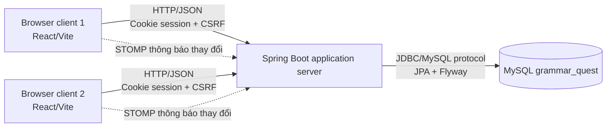
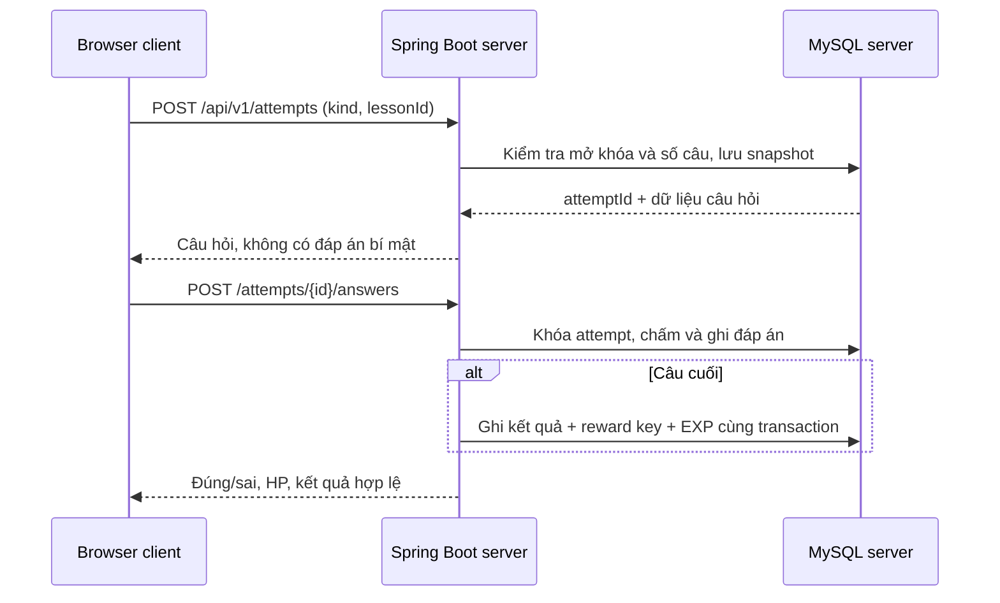

# Kiến trúc và trạng thái triển khai

Backend monolith chia `auth`, `learning`, `classrooms`, `arena`, `admin`, `web` và `domain`. Browser giữ state form/chọn đáp án; server giữ điểm, luật boss, EXP và tiến độ. Mỗi attempt lưu snapshot câu hỏi/đáp án vào `attempt_items`. Sửa ngân hàng câu hỏi sau này không thay đổi lượt làm cũ.

`POST /attempts/{id}/answers` chạy transaction, khóa dòng attempt bằng pessimistic lock. Một câu chỉ nhận một đáp án; gửi lại cùng đáp án trả kết quả cũ, gửi đáp án khác trả `409`. Khi hoàn thành, server ghi kết quả và EXP trong cùng transaction. `xp_ledger` có unique `(user_id,reward_key)`; đồng thời khóa user khi quyết định thưởng, chống hai lượt boss cùng cấp thưởng lần đầu.

Trạng thái attempt: `IN_PROGRESS` → `WON` hoặc `LOST`. `PRACTICE` kết thúc `WON` theo nghĩa hoàn thành, không cấp EXP. Boss bài học 5/5; boss chương 8/10. HP tối thiểu 0. Sau khi hoàn tất boss bài học, bài tiếp theo được mở theo dữ liệu server. Boss chương chỉ mở khi cả bốn boss bài đã thắng.

PvP và chat đã có REST API với dữ liệu MySQL; WebSocket/STOMP đẩy tín hiệu thay đổi đến kênh riêng, client lấy snapshot REST và hỏi định kỳ để dự phòng. PvP dùng khóa hàng phòng khi chấm vòng. Pause/reconnect và giao thức STOMP action đầy đủ **chưa triển khai**. Thiết kế hiện tại và giới hạn xem `PROTOCOL.md`.
