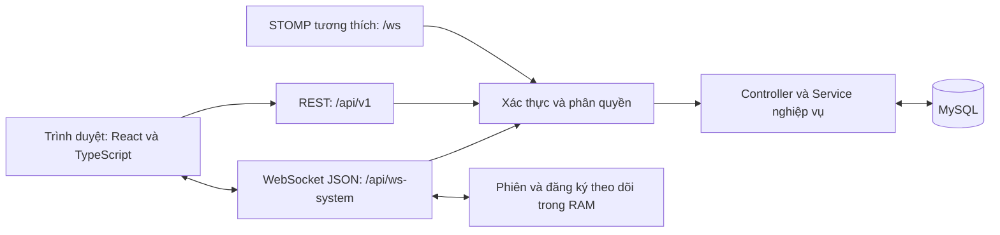
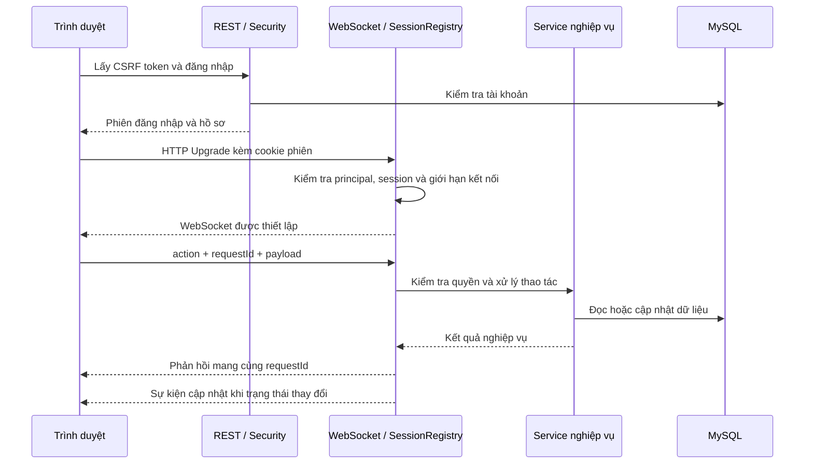
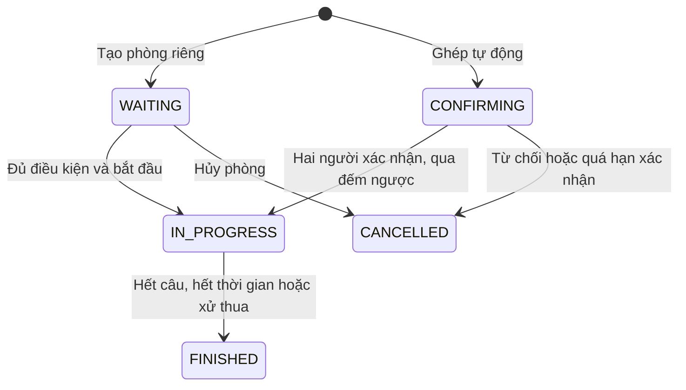

# 8.9. Network Communication Design

## 8.9.1. Mục tiêu và kiến trúc giao tiếp

Grammar Quest là hệ thống học ngữ pháp tiếng Anh có các chức năng học theo lộ trình, luyện tập, giao bài trong lớp, kiểm tra trực tiếp và thi đấu PvP. Các chức năng này có yêu cầu giao tiếp khác nhau: thao tác quản lý cần phản hồi theo từng yêu cầu, trong khi trận đấu và kiểm tra cần cập nhật trạng thái cho nhiều người dùng trong quá trình sử dụng. Vì vậy, hệ thống kết hợp HTTP REST với WebSocket.

Hệ thống tổ chức theo mô hình client–server. Frontend React và TypeScript chạy trên trình duyệt, backend Spring Boot tiếp nhận yêu cầu, xác thực, xử lý nghiệp vụ và truy cập MySQL. Backend là nơi quyết định tính hợp lệ của thao tác, thời hạn làm bài, kết quả chấm điểm và quyền truy cập. Frontend hiển thị dữ liệu do backend trả về, đồng thời quản lý trạng thái tương tác của người dùng.



Trong phiên bản frontend hiện tại, các trang thời gian thực sử dụng WebSocket JSON thông qua `SystemSocketProvider`. Backend đồng thời duy trì cấu hình STOMP cho các kênh thông báo và xử lý tương thích; sự tồn tại của cấu hình này không có nghĩa frontend hiện tại đang mở thêm một kết nối STOMP. Hai cơ chế này cần được phân biệt khi mô tả kiến trúc: thông điệp JSON có trường `action` tại `/api/ws-system` không phải là một frame STOMP. Sơ đồ trình bày các kênh được backend cung cấp, trong đó STOMP là nhánh tương thích.

## 8.9.2. Giao thức và các kênh kết nối

| Kênh | Địa chỉ | Dữ liệu | Vai trò |
| --- | --- | --- | --- |
| HTTP REST | `/api/v1/**` | JSON | Đăng nhập, quản lý tài khoản, kho học liệu, bài tập và các API nghiệp vụ. |
| WebSocket trực tiếp | `/api/ws-system` | JSON trong text message | Giao tiếp hai chiều cho lộ trình, lượt làm, lớp học, kiểm tra, PvP, hỗ trợ và giám sát. |
| STOMP trên WebSocket | `/ws` | Frame STOMP, nội dung nghiệp vụ dạng JSON | Các đích gửi `/app/arena/action`, `/app/classes/message` và hàng đợi thông báo theo người dùng. |
| Kết nối MySQL qua JDBC driver | Backend đến MySQL, cổng mặc định `3306` | Giao thức MySQL trên TCP, truyền yêu cầu SQL và kết quả | Lưu tài khoản, bài học, câu hỏi, lượt làm, bài nộp và kết quả trận đấu. |

JDBC là API truy cập cơ sở dữ liệu của Java. Trong dự án này, MySQL Connector/J hiện thực driver để backend giao tiếp với MySQL; JDBC không phải một giao thức mạng độc lập tương đương HTTP hoặc WebSocket.

HTTP và WebSocket hoạt động trên nền TCP, phù hợp với dữ liệu cần truyền theo thứ tự và có kiểm soát kết nối. Tuy nhiên, đặc tính truyền tin của TCP không đồng nghĩa với việc một thao tác nghiệp vụ được thực hiện đúng một lần. Nếu kết nối mất sau khi server lưu dữ liệu nhưng trước khi client nhận phản hồi, client vẫn cần kiểm tra lại trạng thái để biết thao tác đã thành công hay chưa.

Trong môi trường phát triển, Vite phục vụ frontend tại cổng `5173`, chuyển tiếp `/api` và `/ws` đến backend tại cổng `8080`. Proxy bật hỗ trợ WebSocket. Hàm `systemSocketUrl()` tạo URL theo origin của trang, sử dụng `ws:` với HTTP và `wss:` với HTTPS. Cách tổ chức này giúp REST và WebSocket sử dụng cùng ngữ cảnh cookie đăng nhập của trình duyệt.

Khi triển khai với HTTPS, thành phần reverse proxy hoặc hạ tầng triển khai cần đảm nhiệm TLS và chuyển tiếp kết nối WebSocket. Mã cấu hình hiện tại chưa đủ cơ sở để khẳng định môi trường phát triển đang dùng HTTPS/WSS.

## 8.9.3. Thiết kế thông điệp

### a. Thông điệp WebSocket JSON

Thông điệp có cấu trúc chung:

```json
{
  "action": "ARENA_ANSWER",
  "requestId": "req-example-001",
  "payload": {
    "roomId": 15,
    "roundNo": 1,
    "option": "B"
  }
}
```

| Trường | Ý nghĩa |
| --- | --- |
| `action` | Tên thao tác hoặc loại sự kiện, ví dụ `ARENA_ANSWER`, `EXAM_SUBMIT`. |
| `requestId` | Mã liên kết yêu cầu với phản hồi; frontend hiện tạo bằng `crypto.randomUUID()`. |
| `payload` | Dữ liệu nghiệp vụ, có cấu trúc tùy theo `action`. |

Phản hồi cho một yêu cầu mang lại cùng `requestId`. Sự kiện chủ động từ server thường sử dụng `requestId` rỗng vì không gắn với một yêu cầu đang chờ cụ thể. Frontend phân biệt phản hồi và sự kiện đẩy bằng cả loại `action` lẫn mã yêu cầu.

Một số nhóm thông điệp tiêu biểu:

| Chức năng | Yêu cầu | Phản hồi hoặc sự kiện liên quan |
| --- | --- | --- |
| Hồ sơ | `ACCOUNT_GET` | `ACCOUNT_DATA`, `ACCOUNT_UPDATE` |
| Lộ trình | `ROADMAP_OPEN`, `ROADMAP_LESSON`, `ROADMAP_START`, `ROADMAP_SAVE`, `ROADMAP_SUBMIT` | `ROADMAP_COURSE_DATA`, `ROADMAP_PROGRESS_CHANGED` |
| Lượt làm truyền thống | `GET_ATTEMPT`, `SUBMIT_ANSWER` | `ATTEMPT_DATA`, `ANSWER_RESULT` |
| Kiểm tra lớp | `EXAM_LIST`, `EXAM_OPEN`, `EXAM_ANSWER`, `EXAM_SUBMIT`, `EXAM_SYNC` | `EXAM_DATA`, `EXAM_UPDATE`, `EXAM_ERROR` |
| Tìm đối thủ | `QUEUE_JOIN`, `QUEUE_STATUS`, `QUEUE_CANCEL` | `MATCHMAKING_UPDATE` |
| Phòng đấu | `ARENA_OPEN`, `ARENA_CREATE`, `ARENA_JOIN`, `ARENA_CONFIRM`, `ARENA_ANSWER` | `ARENA_DATA`, `ARENA_ROOM_UPDATE` |
| Theo dõi hoạt động | `CLIENT_ACTIVITY` | `ACTIVITY_UPDATED` |
| Hỗ trợ | `SUPPORT_OPEN`, `SUPPORT_SEND` | `SUPPORT_DATA`, `SUPPORT_UPDATE` |

Danh sách trên mô tả các nhóm chính, không thay thế toàn bộ hợp đồng thông điệp trong mã nguồn.

### b. Quy ước dữ liệu đáp án

Các module hiện chưa dùng hoàn toàn cùng một cách biểu diễn đáp án:

| Module và dạng câu hỏi | Biểu diễn đáp án |
| --- | --- |
| Trắc nghiệm trong lượt làm truyền thống, lộ trình mới và PvP | Chữ `A`, `B`, `C`, `D`. |
| Câu nhập chữ trong lượt làm truyền thống hoặc bài tập lớp | Chuỗi văn bản. |
| Trắc nghiệm trong kiểm tra trực tiếp | Chỉ số lựa chọn từ `0` đến `3`. |
| Câu nhập chữ trong kiểm tra trực tiếp | Chuỗi văn bản. |

Quy ước A/B/C/D chỉ áp dụng cho câu trắc nghiệm của các luồng tương ứng, không áp dụng cho mọi câu hỏi trong lượt làm truyền thống. Frontend phải tạo đúng payload cho từng module, còn backend kiểm tra kiểu dữ liệu trước khi chấm.

Ví dụ nộp bài kiểm tra trực tiếp:

```json
{
  "action": "EXAM_SUBMIT",
  "requestId": "req-example-002",
  "payload": {
    "examId": 21,
    "version": 3,
    "answers": {
      "q1": 1,
      "q2": "since"
    }
  }
}
```

Trường `version` cho biết phiên bản đề mà học viên đang làm. Nếu giáo viên đã thay đổi đề, backend từ chối thao tác sử dụng phiên bản cũ để tránh chấm đáp án trên một cấu trúc câu hỏi khác.

### c. Thông điệp lỗi

REST sử dụng mã trạng thái HTTP; mẫu lỗi chung có các trường như `code`, `message`, `fields`, `requestId`. Một số lỗi được trả sớm từ filter có cấu trúc rút gọn, chẳng hạn lỗi giới hạn tốc độ chỉ chứa `code`, `message` và header `Retry-After`. Do đó, không phải mọi phản hồi lỗi đều có đủ bốn trường. WebSocket trả sự kiện `ERROR` cho lỗi của yêu cầu; một số luồng theo dõi còn có sự kiện lỗi riêng như `EXAM_ERROR`.

```json
{
  "action": "ERROR",
  "requestId": "req-example-002",
  "payload": {
    "code": "SERVER_BUSY",
    "message": "Máy chủ đang bận. Vui lòng thử lại sau vài giây.",
    "retryAfterSeconds": 3
  }
}
```

`requestId` phục vụ đối chiếu phản hồi, không tự tạo ra cơ chế chống thực hiện trùng. Với thao tác có yêu cầu chống trùng, hệ thống sử dụng thêm khóa nghiệp vụ, trạng thái trong DB hoặc mã yêu cầu được lưu cùng dữ liệu.

## 8.9.4. Thiết lập, duy trì và đóng kết nối

Quá trình thiết lập kết nối diễn ra theo các bước:

1. Trình duyệt lấy CSRF token và gửi yêu cầu đăng nhập qua REST.
2. Sau khi xác thực thành công, backend duy trì danh tính bằng HTTP session; trình duyệt gửi cookie `JSESSIONID` trong các yêu cầu tiếp theo.
3. `SystemSocketProvider` tạo WebSocket đến `/api/ws-system`.
4. `SocketSessionRegistry` kiểm tra handshake và liên kết socket với đúng HTTP session đã xác thực.
5. `SystemSocketHandler` lấy người dùng từ principal, kiểm tra tài khoản và cấp phát trạng thái `UserSession`.
6. Khi socket mở, frontend gửi thông điệp đăng ký hoạt động, sau đó gửi các yêu cầu đã được xếp chờ trước handshake.



Mỗi tab sử dụng một kết nối WebSocket dùng chung cho các trang thông qua React Context. Server vẫn quản lý từng socket riêng vì một tài khoản có thể mở nhiều tab. `UserSession` lưu hoạt động hiện tại, thời điểm tương tác, heartbeat và thông tin tài nguyên đang được cấp phát.

Server duy trì kết nối bằng control frame Ping/Pong. Tác vụ bảo trì chạy theo chu kỳ `fixedDelay` 10 giây: gửi Ping cho socket còn hợp lệ, ngắt socket nếu không nhận Pong quá 90 giây hoặc không có thao tác người dùng trong 15 phút. Trình duyệt xử lý Pong ở tầng WebSocket; cơ chế này không yêu cầu viết một thông điệp JSON `PONG` trong frontend.

Khi đăng xuất, HTTP session hết hiệu lực hoặc tài khoản không còn hợp lệ, kết nối liên quan được thu hồi. Khi socket đóng, các đăng ký theo dõi, liên kết bộ đề và trạng thái RAM tương ứng được giải phóng.

## 8.9.5. Đồng bộ trạng thái và phục hồi kết nối

Frontend giữ danh sách yêu cầu đang chờ trong một `Map`, mỗi yêu cầu có Promise và bộ đếm thời gian riêng. Thời gian chờ hiện tại là 15 giây, tối đa 100 yêu cầu đang chờ. Nếu kết nối đóng, các Promise đang chờ bị từ chối để giao diện thoát trạng thái chờ và thông báo lỗi.

Với lỗi kết nối thông thường, frontend thử kết nối lại sau 3 giây. Khi server trả mã đóng `1013` do giới hạn tài nguyên, thời gian thử lại là khoảng 5–10 giây. Với mã `4005` do gửi đáp án quá nhanh, frontend chờ 10 giây. Các trường hợp session kết thúc, tài khoản bị khóa hoặc quản trị viên chủ động ngắt kết nối có quy tắc xử lý riêng; frontend không tự kết nối lại vô điều kiện.

Sau khi kết nối lại, trang đang sử dụng yêu cầu snapshot mới từ server. Những thao tác đã gửi trước khi mất kết nối không được tự động phát lại toàn bộ, vì phát lại có thể làm trùng hành động. Với thao tác quan trọng như nộp bài, client cần đọc lại trạng thái đã lưu trước khi quyết định thử lại.

Hệ thống kết hợp phản hồi trực tiếp với các đăng ký theo dõi:

- Kiểm tra trực tiếp sử dụng `version`, `revision` và snapshot để nhận biết dữ liệu thay đổi. Frontend kiểm tra các giá trị này để tránh áp dụng trạng thái cũ.
- Phòng đấu sử dụng `stateVersion`. Server gửi snapshot được cá nhân hóa cho người nhận khi phiên bản trạng thái thay đổi.
- Tác vụ theo dõi kiểm tra và PvP được cấu hình `fixedDelay` 1 giây. Riêng component kiểm tra lớp còn gửi yêu cầu đồng bộ dự phòng mỗi 5 giây.

Chu kỳ cấu hình không phải cam kết độ trễ tuyệt đối. Thời gian cập nhật thực tế còn phụ thuộc thời gian truy vấn DB, lịch thực thi tác vụ, tải hệ thống và kết nối mạng.

## 8.9.6. Phân quyền và giới hạn tài nguyên

Danh tính được lấy từ phiên đăng nhập, không lấy từ `userId`, `username` hay `role` do client tự gửi. Thông điệp `AUTH` trên WebSocket phục vụ đăng ký chế độ nhận thông tin; nó không cho phép client tự nâng quyền thành quản trị viên. Các thao tác nghiệp vụ tiếp tục kiểm tra vai trò và quyền sở hữu trong backend.

| Đối tượng dữ liệu | Nguyên tắc truy cập |
| --- | --- |
| Lớp học | Giáo viên sở hữu lớp và học viên còn là thành viên mới được truy cập theo phạm vi cho phép. |
| Bảng điểm lớp | Giáo viên xem kết quả lớp; học viên xem kết quả của chính mình. |
| Kiểm tra trực tiếp | Kiểm tra thành viên, phiên bản đề, hạn làm bài và trạng thái nộp. Học viên không mở được bài đã đóng hoặc hết hạn. |
| Phòng đấu | Chỉ người tham gia được thực hiện hành động tương ứng trong phòng. |
| Kho học liệu | Giáo viên thao tác trên tài nguyên thuộc quyền quản lý của mình. |
| Quản trị hệ thống | Kiểm tra quyền ADMIN ở backend. |

Server lọc dữ liệu trước khi trả cho client. Ví dụ, câu hỏi PvP đang mở không chứa đáp án đúng; học viên không nhận đáp án của bài tập lớp trước khi có một lượt đạt hợp lệ. Với bài kiểm tra trực tiếp đã đóng, backend không trả danh sách câu hỏi cho học viên, kể cả khi gọi lại luồng lấy snapshot.

Các giới hạn mặc định được cấu hình gồm 200 socket trên server, 5 socket cho mỗi tài khoản và 32 yêu cầu nghiệp vụ đồng thời qua cơ chế kiểm soát tải. Tomcat cấu hình tối đa 64 thread xử lý HTTP, HikariCP tối đa 16 kết nối DB. Đây là thông số cấu hình, chưa phải kết quả đo tải hay số người dùng đồng thời đã được chứng minh bằng thử nghiệm.

WebSocket cấu hình `maxTextMessageBufferSize(131072)` tại container; con số này là giá trị cấu hình bộ đệm văn bản, không nên tự diễn giải thành kích thước byte UTF-8 của mọi payload Unicode. Decorator của socket hệ thống có bộ đệm gửi `524288` byte và giới hạn thời gian gửi 5 giây.

`AnswerRateLimiter` dùng cửa sổ trượt theo tài khoản: khi vượt 10 yêu cầu được kiểm soát trong một giây, tài khoản bị tạm chặn tại limiter trong 10 giây. Phạm vi tích hợp hiện tại gồm:

- REST: POST đáp án tới `/api/v1/attempts/{id}/answers` và `/api/v1/arena/rooms/{id}/answers`.
- WebSocket JSON: `SUBMIT_ANSWER`, `ARENA_ANSWER`, `EXAM_ANSWER`, `ROADMAP_SUBMIT`, `PLACEMENT_SUBMIT`.
- STOMP: hành động `ANSWER` gửi tới `/app/arena/action`.

Các đường này dùng chung trạng thái limiter theo tài khoản. Không nên hiểu đây là giới hạn cho mọi API hoặc mọi sự kiện; ví dụ `EXAM_SUBMIT` và `ROADMAP_SAVE` không nằm trong các nhánh gọi limiter trên.

# 8.10. Implementation

## 8.10.1. Công nghệ và tổ chức mã nguồn

Frontend sử dụng React 19, TypeScript và Vite. Backend sử dụng Java 21, Spring Boot 3.5.7, Spring Security, Spring WebSocket, Spring Data JPA và `JdbcTemplate`. MySQL lưu dữ liệu nghiệp vụ, Flyway quản lý phiên bản cấu trúc DB. Các phiên bản này được xác định từ cấu hình dự án tại thời điểm lập báo cáo.

Mã nguồn chia thành ba phần:

| Thư mục | Nội dung |
| --- | --- |
| `source/client` | Giao diện, trạng thái React, gọi REST và xử lý WebSocket phía trình duyệt. |
| `source/server` | Controller, service, entity, repository, bảo mật, WebSocket và migration. |
| `source/common` | Tài liệu giao tiếp và các quy ước dùng chung. |

Luồng xử lý tổng quát là: giao diện phát yêu cầu, tầng giao tiếp kiểm tra và định tuyến, controller/service thực hiện nghiệp vụ, repository hoặc JDBC truy cập DB, sau đó kết quả được chuyển thành dữ liệu phù hợp với người nhận.

Trong mã hiện tại, một số nghiệp vụ được đặt trực tiếp trong controller và các `Socket*Service` gọi lại controller để tái sử dụng xử lý. Việc phân chia trách nhiệm giữa tầng tiếp nhận yêu cầu và tầng nghiệp vụ vì vậy chưa hoàn toàn tách biệt. Tách thêm nghiệp vụ khỏi controller là hướng có thể tiếp tục cải thiện.

## 8.10.2. Các module và class chính

| Module | Thành phần tiêu biểu | Trách nhiệm |
| --- | --- | --- |
| Giao tiếp frontend | `SystemSocketContext.tsx`, `systemSocket.ts`, `api.ts` | Quản lý socket, Promise chờ phản hồi, kết nối lại, REST, cookie và CSRF. |
| Tiếp nhận WebSocket | `SystemSocketHandler` | Định tuyến `action`, kiểm tra người dùng, quản lý đăng ký theo dõi, trả phản hồi và đẩy cập nhật. |
| Phiên và bảo mật | `SecurityConfig`, `SocketSessionRegistry`, `UserSession`, `AnswerRateLimiter` | Xác thực, liên kết HTTP session với socket, lưu trạng thái phiên và giới hạn tốc độ. |
| Học tập | `LearningService`, `SocketLearningService` | Tạo lượt làm, lưu snapshot, tiếp nhận đáp án, chấm điểm và trả kết quả. |
| Lộ trình mới | `RoadmapCourseService`, `PlacementService` | Kiểm tra đầu vào, truy cập level/module, tạo bài học và lượt ôn tập. |
| Lớp và bài tập | `ClassroomController`, `SocketClassroomService`, `AssignmentResults` | Quản lý lớp, giao bài, truy cập bài nộp và tổng hợp điểm từ lịch sử. |
| Kiểm tra trực tiếp | `LiveExamService`, `LiveClassExam.tsx` | Quản lý phiên bản đề, lưu nháp, nộp bài và theo dõi kết quả. |
| PvP | `ArenaController`, `SocketArenaService`, `ArenaMatchmaker`, `ArenaMatchFactory` | Tạo và ghép phòng, xử lý trạng thái trận, câu trả lời, điểm và ELO. |
| Snapshot PvP | `ArenaSnapshotStore` | Dùng chung gói câu hỏi an toàn trong RAM giữa các socket theo dõi cùng phòng. |
| Đồng bộ và giám sát | `RealtimeNotifier`, `RealtimeSchedulerConfig`, `NetworkEventLog` | Thông báo sau commit, lập lịch tác vụ và lưu nhật ký mạng giới hạn trong RAM. |
| Nhiệm vụ | `DailyQuestService`, `DailyQuestsContext.tsx` | Theo dõi tiến độ nhiệm vụ, nhận thưởng, chuỗi ngày và đồng bộ hồ sơ. |

## 8.10.3. Xử lý yêu cầu bất đồng bộ trên frontend

`SystemSocketProvider` cung cấp hai thao tác chính cho các component: `request()` để gửi yêu cầu có phản hồi và `subscribe()` để nhận sự kiện chủ động từ server.

Thuật toán gửi yêu cầu được khái quát như sau:

```text
request(action, expectedAction, payload):
    nếu số yêu cầu đang chờ >= 100:
        từ chối yêu cầu mới
    tạo requestId
    tạo timer 15 giây
    lưu Promise, expectedAction và thông điệp vào pending[requestId]
    nếu socket đã mở:
        gửi thông điệp và đánh dấu đã gửi

khi nhận thông điệp:
    phân tích JSON và kiểm tra action
    tìm pending theo requestId
    nếu action là expectedAction hoặc ERROR:
        hủy timer và xóa pending
        hoàn tất hoặc từ chối Promise
    chuyển sự kiện đến các subscriber
```

Thiết kế này cho phép nhiều trang dùng chung một kết nối mà vẫn phân biệt được phản hồi của từng yêu cầu. Khi component hủy đăng ký bằng hàm do `subscribe()` trả về, listener tương ứng được xóa. Timer của yêu cầu được hủy khi nhận phản hồi phù hợp hoặc khi socket/provider đóng và từ chối các yêu cầu đang chờ; nếu không nhận phản hồi, timer tự hết hạn sau 15 giây. Việc hủy một subscription không tự động hủy mọi yêu cầu đã gửi từ component đó.

Đối với REST, `api.ts` tập trung việc thêm `credentials: 'include'`, tạo `X-Request-Id`, lấy CSRF token và xử lý mã lỗi. Khi nhận HTTP 401 ngoài luồng đăng nhập, frontend phát sự kiện để cập nhật trạng thái xác thực thay vì tiếp tục sử dụng giao diện như một phiên còn hợp lệ.

## 8.10.4. Lưu câu hỏi, lượt làm và kết quả bài tập

Hệ thống lưu nội dung câu hỏi vào snapshot của lượt làm hoặc bài đã giao. Snapshot giúp nội dung của bài đã phát hành ổn định khi giáo viên chỉnh sửa kho câu hỏi gốc. Bộ câu hỏi trong kho học liệu có thể được tái sử dụng để giao cho nhiều lớp, trong khi từng bài giao vẫn có tên, hạn nộp và quy tắc đạt riêng.

Khi học viên bắt đầu bài tập lớp, backend kiểm tra thành viên, trạng thái bài và hạn nộp. Nếu đã có lượt đang làm còn hiệu lực, hệ thống trả lại lượt đó; nếu không, hệ thống tạo lượt mới và liên kết với bài giao qua `assignment_attempts`. Mỗi lượt có giới hạn làm bài; thời hạn hợp lệ được xét đồng thời với hạn của bài tập.

Các lượt cũ được giữ lại. `AssignmentResults` tổng hợp dữ liệu khi đọc, tách các giá trị:

- Điểm chính thức: điểm cao nhất của các lượt đã hoàn thành đúng hạn.
- Điểm lần đầu: kết quả của lượt hoàn thành đầu tiên.
- Điểm gần nhất: dữ liệu của lượt mới nhất.
- Số lượt bắt đầu, số lượt đã nộp và thời điểm đạt lần đầu.

Một học viên đã có lượt đạt hợp lệ không bị mất trạng thái Đạt khi bắt đầu làm lại hoặc nộp lượt sau với điểm thấp hơn. Chính sách mở đáp án cũng dựa trên việc đã có một lượt đạt hợp lệ. Việc ẩn đáp án được thực hiện khi tạo dữ liệu trả về trong backend, thay vì chỉ ẩn một phần giao diện.

Điểm tốt nhất được so sánh theo tỷ lệ `correctCount / totalQuestions`. Một lượt hợp lệ phải có `completedAt` không vượt quá giá trị nhỏ hơn giữa hạn của lượt làm và hạn bài giao; yêu cầu đạt được tính bằng `correctCount × 100 >= totalQuestions × passPercent`. Cụm “giữ trạng thái Đạt” ở đây mô tả hành vi khi học viên làm lại, không khẳng định trạng thái sẽ bất biến nếu giáo viên thay đổi ngưỡng đạt hoặc hạn nộp của bài giao.

Với câu nhập chữ trong `LearningService`, bộ chấm chuẩn hóa chữ hoa/thường, khoảng trắng và dấu câu cuối trước khi so sánh với đáp án mẫu. Đây là phép so khớp theo quy tắc, không phải chấm ngữ nghĩa bằng mô hình AI; một cách diễn đạt tương đương nhưng khác đáp án mẫu vẫn có thể không được nhận là đúng.

## 8.10.5. Xử lý kiểm tra trực tiếp

Mỗi bài kiểm tra có phiên bản đề, thời hạn và dữ liệu bài làm theo từng học viên. `LiveExamService` kiểm tra quyền lớp, trạng thái đóng/mở và phiên bản trước khi chấp nhận lưu hoặc nộp.

Frontend hiển thị lựa chọn ngay khi học viên thao tác, sau đó xếp các yêu cầu lưu vào hàng đợi Promise để gửi tuần tự. Câu nhập chữ có debounce 600 ms, giảm số yêu cầu khi người dùng đang gõ. Dữ liệu chưa lưu được giữ riêng để một phản hồi cũ không ghi đè lựa chọn mới.

Khi nộp, frontend chờ các tác vụ đã xếp hàng và gửi kèm toàn bộ đáp án hiện tại. Backend xác thực các mã câu hỏi, kiểu dữ liệu và phiên bản, rồi lưu đáp án cuối cùng cùng kết quả chấm trong giao dịch. Cách này xử lý tình huống một lần tự lưu thất bại nhưng dữ liệu mới nhất vẫn được gửi trong yêu cầu nộp bài.

Các thao tác cập nhật bài kiểm tra sử dụng khóa hàng DB. Vì vậy, chỉnh đề, lưu đáp án và nộp bài đồng thời được xử lý trên trạng thái đã kiểm soát. Nếu phiên bản đề thay đổi, yêu cầu từ phiên bản cũ bị từ chối thay vì được chấm âm thầm.

Khi bài hết hạn hoặc đã đóng, học viên không thể mở lại danh sách câu hỏi; giao diện đang mở cũng tự thu hồi phần đề. Backend tiếp tục lọc câu hỏi khỏi snapshot dành cho học viên. Giáo viên vẫn xem được nội dung và bảng kết quả để quản lý lớp.

## 8.10.6. Thuật toán ghép trận và điều khiển PvP

### a. Ghép đối thủ

`ArenaMatchmaker` lưu hàng chờ trong RAM. Trước khi ghép, hệ thống kiểm tra lại quyền LEARNER, trạng thái khóa tài khoản, hạn cấm PvP, phòng đang tham gia, cấp độ và ELO hiện tại.

Phạm vi ghép được mở rộng theo thời gian chờ:

| Thời gian chờ | Chênh lệch cấp cho phép | Chênh lệch ELO cho phép |
| --- | --- | --- |
| Dưới 15 giây | 0 | 150 |
| Từ 15 đến dưới 30 giây | 1 | 300 |
| Từ 30 giây | 2 | 600 |

Một cặp chỉ hợp lệ khi thỏa phạm vi của cả hai người; mã nguồn lấy giá trị nhỏ hơn giữa hai ngưỡng. Trong các ứng viên hợp lệ, hệ thống ưu tiên chênh lệch ELO nhỏ nhất, sau đó chênh lệch cấp nhỏ nhất và thời điểm vào hàng chờ sớm hơn. Cấp được sử dụng ở đây tính từ EXP học tập; không đồng nhất với level nội dung của lộ trình mới.

Thuật toán hiện duyệt danh sách ứng viên cho từng người chờ, có độ phức tạp xấu nhất bậc hai theo số người trong hàng chờ, chưa tính chi phí truy vấn xác minh. Cách làm đơn giản về tổ chức dữ liệu, nhưng chưa đủ cơ sở để khẳng định đáp ứng một quy mô tải cụ thể khi chưa đo tải. Nếu hàng chờ lớn, có thể tổ chức chỉ mục theo khoảng ELO và cấp.

### b. Trạng thái và chấm điểm trận đấu



Phòng ghép tự động có 15 giây xác nhận và 5 giây đếm ngược. Trận sử dụng tối đa 10 câu hỏi, 20 giây cho mỗi câu và giới hạn toàn trận 180 giây. Các mốc thời gian do backend xác lập; đồng hồ frontend chỉ phục vụ hiển thị.

Khi nhận đáp án, backend khóa hàng phòng đấu bằng `SELECT ... FOR UPDATE`, kiểm tra người tham gia, số vòng, thời hạn và việc đã trả lời hay chưa. Mỗi người được ghi nhận một đáp án cho một vòng. Khi cả hai đã trả lời hoặc hết thời gian, vòng đóng và điểm được cập nhật: đúng cộng một điểm, sai hoặc không trả lời không có điểm.

Khi trận kết thúc, người có điểm cao hơn thắng. Nếu bằng điểm, hệ thống so sánh tổng thời gian trả lời của các câu đúng; người có tổng thời gian nhỏ hơn thắng. Nếu vẫn bằng nhau, kết quả là hòa. Bỏ trận hoặc không quay lại sau khoảng phục hồi có thể dẫn đến xử thua theo trạng thái phòng.

Hệ thống phát hiện người chơi mất hoạt động theo mốc 8 giây và cho khoảng 30 giây kết nối lại. Khi phục hồi, backend điều chỉnh các mốc hạn theo xử lý tạm dừng. Cơ chế này phụ thuộc presence mà server quan sát được, khác với cơ chế Ping/Pong duy trì toàn bộ socket hệ thống.

### c. Cập nhật ELO

`PvpRankRules` tính thay đổi ELO theo công thức:

```text
E = 1 / (1 + 10 ^ ((R_opponent - R_player) / 400))
delta = round(32 × (S - E))
R_new = max(100, R_old + delta)
```

Trong đó `S` lần lượt bằng `1`, `0.5`, `0` cho thắng, hòa và thua. ELO khởi tạo là 1000; trường hợp thắng hoặc thua có điều chỉnh để độ thay đổi tối thiểu tương ứng là +1 hoặc -1. Với hai người cùng ELO, một trận thắng/thua thông thường tạo thay đổi khoảng +16/-16 trước khi áp dụng ngưỡng tối thiểu ELO.

ELO được dùng cho phân hạng và ghép trận, tách biệt với EXP học tập. Bảng xếp hạng hiện lấy tối đa 50 học viên, sắp theo ELO giảm dần, rồi số trận thắng giảm dần và ID tăng dần khi cần phân định tiếp.

## 8.10.7. Quản lý snapshot và bộ nhớ dùng chung

`ArenaSnapshotStore` là thành phần tối ưu việc cấp phát câu hỏi PvP. Lớp duy trì hai cấu trúc:

| Cấu trúc | Khóa → giá trị | Vai trò |
| --- | --- | --- |
| `packets` | `roomId → Packet` | Gói câu hỏi của từng phòng đang có socket tham chiếu. |
| `bindings` | `clientId → roomId` | Liên kết một socket với phòng đang theo dõi. |

`Packet` chứa danh sách câu hỏi và tập socket đang sử dụng. Câu hỏi chỉ gồm số vòng, đề bài và các lựa chọn; không có đáp án đúng. Danh sách được tạo bằng `List.copyOf()`, còn các lựa chọn được tạo bằng `List.of()`, giúp nội dung gói sau khi cấp phát không bị thay đổi tùy ý.

Khi gọi `acquire(client, room)`, lớp sử dụng `ConcurrentHashMap.compute()` để cập nhật liên kết và cấp phát gói nếu chưa có. Nếu client chuyển phòng, tham chiếu ở phòng trước được giải phóng. Khi `release(client)` được gọi, socket bị xóa khỏi tập tham chiếu; gói được bỏ khỏi RAM khi không còn socket sử dụng.

Phần nội dung câu hỏi là bất biến, còn tập tham chiếu `clients` vẫn thay đổi trong quá trình sử dụng. Tập này được cập nhật bên trong phép `compute()` theo khóa phòng để phối hợp truy cập đồng thời. Đây là cơ chế quản lý tham chiếu ở mức ứng dụng, không phải một hệ thống cache phân tán.

## 8.10.8. Xử lý đồng thời và bảo đảm nhất quán

Hệ thống sử dụng cả đồng bộ trong tiến trình và giao dịch DB, vì hai cơ chế giải quyết các phạm vi khác nhau.

| Tình huống | Cơ chế trong mã nguồn | Mục đích |
| --- | --- | --- |
| Hai tác vụ cùng thay đổi hàng chờ PvP | Các phương thức `synchronized` của `ArenaMatchmaker` | Hạn chế một người bị ghép đồng thời vào nhiều cặp trong cùng tiến trình. |
| Nhiều yêu cầu đồng thời muốn vào xử lý | `ServerCapacity` sử dụng `Semaphore.tryAcquire()` | Giới hạn số yêu cầu đang xử lý, từ chối khi hết suất thay vì thêm vào hàng chờ không giới hạn. |
| Nhiều socket truy cập cấu trúc phiên | `ConcurrentHashMap`, phương thức đồng bộ của `UserSession` | Bảo vệ trạng thái dùng chung trong RAM. |
| Nhiều luồng gửi cùng socket | `ConcurrentWebSocketSessionDecorator` | Phối hợp gửi và giới hạn bộ đệm, thời gian gửi. |
| Hai người trả lời cùng lúc, timer đồng thời đóng vòng | Giao dịch và khóa hàng phòng PvP | Chấm và chuyển trạng thái trên dữ liệu nhất quán. |
| Giáo viên sửa đề khi học viên đang lưu/nộp | Khóa hàng bài kiểm tra và kiểm tra `version` | Tránh chấm theo một phiên bản đề không tương ứng. |
| Gửi lặp yêu cầu tạo lượt học theo lộ trình | `requestKey`, tra cứu lượt đã tạo và khóa enrollment | Giảm tạo trùng lượt cho cùng yêu cầu nghiệp vụ. |
| Nhận phần thưởng nhiều lần | Giao dịch, khóa dữ liệu và kiểm tra khóa thưởng trong XP ledger | Tránh cộng EXP lặp cho cùng phần thưởng. |
| Đẩy thông báo trước khi DB hoàn tất | `RealtimeNotifier.afterCommit()` | Chỉ phát các thông báo đăng ký theo cơ chế này sau khi giao dịch commit. |

Không phải mọi thông điệp WebSocket đều đi qua `afterCommit()`. Phản hồi yêu cầu được gửi khi lời gọi nghiệp vụ trả về; các tác vụ theo dõi định kỳ đọc snapshot để phát hiện thay đổi. Do đó, báo cáo phân biệt cơ chế thông báo sau commit với cơ chế so sánh snapshot theo lịch.

`RealtimeSchedulerConfig` cấu hình pool 8 thread cho tác vụ định kỳ. Các tác vụ gồm bảo trì kết nối, theo dõi phòng đấu, cập nhật kiểm tra và các thông tin giám sát. Số thread này độc lập với giới hạn thread HTTP của Tomcat và pool kết nối DB.

Khi `ArenaMatchFactory` tạo phòng ghép tự động, hai hàng tài khoản được khóa theo thứ tự ID tăng dần. Thứ tự khóa nhất quán giúp giảm nguy cơ các thao tác cùng lúc chờ khóa theo chiều ngược nhau; không nên diễn giải rằng chỉ riêng `synchronized` đã bảo đảm mọi cập nhật DB hoặc mọi tình huống đa tiến trình.

## 8.10.9. Theo dõi lỗi, kiểm thử và phạm vi triển khai

`NetworkEventLog` lưu tối đa 200 sự kiện gần nhất trong RAM bằng `ArrayDeque`; khi đầy, sự kiện cũ nhất bị loại bỏ. `UserSession` ghi bộ đếm thông điệp, thời gian kết nối, heartbeat và tài nguyên đang cấp phát để hỗ trợ trang giám sát. Nhật ký RAM phục vụ theo dõi vận hành, không thay thế audit được lưu bền vững trong DB.

Mã nguồn có kiểm thử cho quản lý socket, session, giới hạn tốc độ, ghép trận, snapshot PvP, xử lý kiểm tra đồng thời và luồng kho học liệu/lớp học. Các script Playwright kiểm tra giao diện cùng tương tác như lưu nháp, nộp bài, phân trang và truy cập theo vai trò. Một số kiểm thử tích hợp DB chỉ chạy khi bật biến môi trường tương ứng; vì vậy, không nên đồng nhất việc chạy lệnh test mặc định với việc mọi kiểm thử tích hợp đều đã thực thi.

Kiến trúc hiện tại có nhiều trạng thái tạm thời nằm trong bộ nhớ một tiến trình: socket, hàng chờ ghép trận, đăng ký theo dõi và gói snapshot. Khi backend khởi động lại, các trạng thái RAM này mất; dữ liệu nghiệp vụ đã commit trong MySQL vẫn được giữ. Hệ thống chưa thể được mô tả là đã hỗ trợ mở rộng ngang hoàn chỉnh chỉ dựa trên cấu hình thread pool. Muốn chạy nhiều backend cần bổ sung cách chia sẻ hoặc định tuyến nhất quán các trạng thái liên quan.

Về chính sách origin, REST và STOMP có cấu hình nguồn được phép, nhưng raw WebSocket hiện đăng ký `setAllowedOrigins("*")`. Vì vậy, mô tả đúng hiện trạng là kết nối raw có kiểm tra phiên đăng nhập, còn chính sách giới hạn origin của kênh này chưa đồng nhất với hai kênh còn lại.

Các điểm có thể tiếp tục hoàn thiện gồm tách nghiệp vụ khỏi controller, chuẩn hóa biểu diễn đáp án giữa các module, quản lý hàng chờ/tác vụ trên hạ tầng dùng chung khi mở rộng nhiều máy và đo tải thực tế để hiệu chỉnh giới hạn tài nguyên. Đây là hướng phát triển, không phải các tính năng đã được xác nhận triển khai.

## Đối chiếu mã nguồn

Các nội dung trên được lập từ mã nguồn trong repository, ưu tiên hiện thực đang có khi tài liệu mô tả cũ khác với code.

| Nội dung cần đối chiếu | Tệp |
| --- | --- |
| WebSocket dùng chung, timeout và reconnect | [SystemSocketContext.tsx](source/client/src/app/SystemSocketContext.tsx) |
| REST và CSRF | [api.ts](source/client/src/services/api.ts), [SecurityConfig.java](source/server/src/main/java/com/grammarquest/security/SecurityConfig.java) |
| Endpoint và đăng ký STOMP | [WebSocketConfig.java](source/server/src/main/java/com/grammarquest/config/WebSocketConfig.java), [RealtimeConfig.java](source/server/src/main/java/com/grammarquest/config/RealtimeConfig.java) |
| Định tuyến, heartbeat và push | [SystemSocketHandler.java](source/server/src/main/java/com/grammarquest/websocket/SystemSocketHandler.java) |
| Phiên đăng nhập và tài nguyên socket | [SocketSessionRegistry.java](source/server/src/main/java/com/grammarquest/security/SocketSessionRegistry.java), [UserSession.java](source/server/src/main/java/com/grammarquest/websocket/UserSession.java) |
| Snapshot và ghép trận | [ArenaSnapshotStore.java](source/server/src/main/java/com/grammarquest/service/ArenaSnapshotStore.java), [ArenaMatchmaker.java](source/server/src/main/java/com/grammarquest/service/ArenaMatchmaker.java) |
| Trạng thái trận và ELO | [ArenaController.java](source/server/src/main/java/com/grammarquest/controller/ArenaController.java), [PvpRankRules.java](source/server/src/main/java/com/grammarquest/util/PvpRankRules.java) |
| Kiểm tra trực tiếp | [LiveExamService.java](source/server/src/main/java/com/grammarquest/service/LiveExamService.java), [LiveClassExam.tsx](source/client/src/components/LiveClassExam.tsx) |
| Lượt làm, điểm bài tập và lịch sử | [LearningService.java](source/server/src/main/java/com/grammarquest/service/LearningService.java), [ClassroomController.java](source/server/src/main/java/com/grammarquest/controller/ClassroomController.java), [AssignmentResults.java](source/server/src/main/java/com/grammarquest/service/AssignmentResults.java) |
| Lộ trình và yêu cầu chống trùng | [RoadmapCourseService.java](source/server/src/main/java/com/grammarquest/service/RoadmapCourseService.java) |
| Thông báo sau commit | [RealtimeNotifier.java](source/server/src/main/java/com/grammarquest/service/RealtimeNotifier.java) |
| Giới hạn tốc độ và cấu hình tài nguyên | [AnswerRateLimiter.java](source/server/src/main/java/com/grammarquest/security/AnswerRateLimiter.java), [AnswerRateFilter.java](source/server/src/main/java/com/grammarquest/security/AnswerRateFilter.java), [ServerCapacity.java](source/server/src/main/java/com/grammarquest/security/ServerCapacity.java), [application.yml](source/server/src/main/resources/application.yml) |
